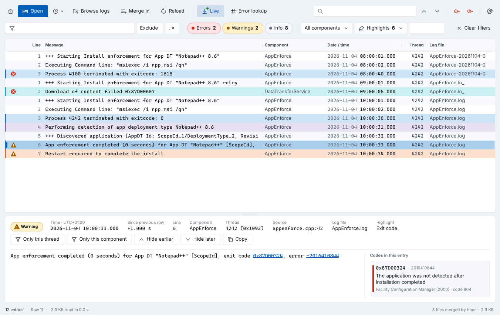
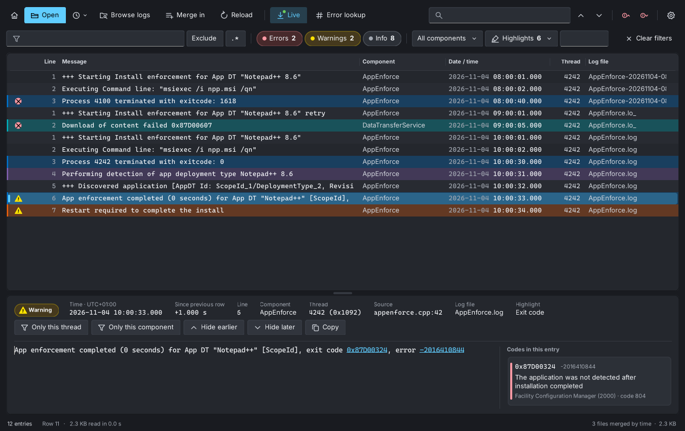
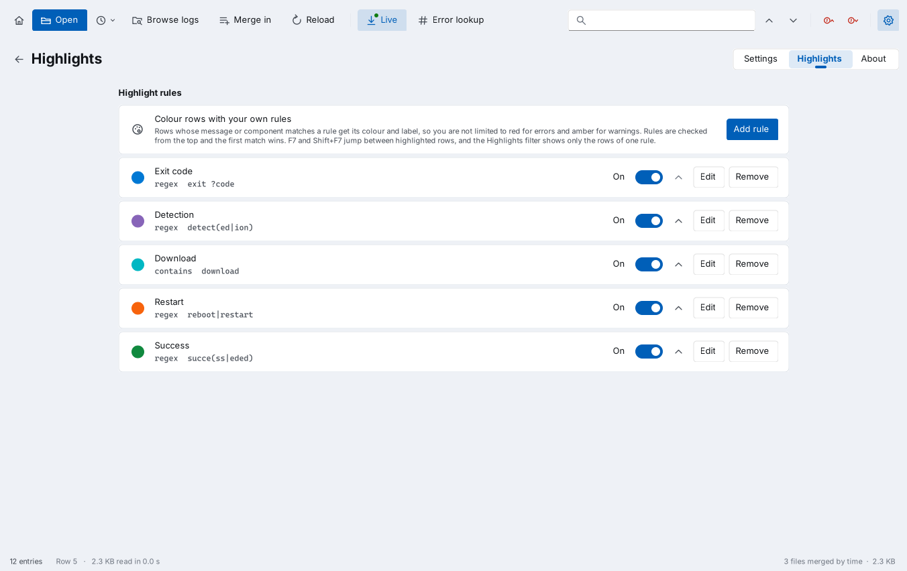

# Changelog

All versions of Trace Lens, newest first.

### At a glance

| Version | Highlights | Upgrade |
|---|---|---|
| **1.3.2** (latest) | Theme button in the toolbar, asks for administrator rights when a log needs them, more reliable Connect as | Run the MSI. It replaces any earlier version |
| 1.3.1 | Sharper, easier-to-read look: striped rows, colour bars, clearer timestamps, larger detail text | |
| 1.3.0 | Windows Update ETL logs, Home button, Connect as, auto-merge, linked error codes, highlight rules, line numbers | |
| 1.2.x | New logo, developer named, Browse logs with automatic log discovery, Settings and About | |
| 1.1.0 | Windows 11 style with light and dark themes | |

## Trace Lens 1.3.2

Trace Lens 1.3.2, released on 5 November 2026, adds a theme button, asks for administrator rights when a log needs them, and makes Connect as easier to use and more reliable.

### New in 1.3.2

- **Theme button**: the moon next to the gear switches to the dark theme, and the sun switches back to light. System is still under Settings > Appearance.
- **Administrator rights when needed**: when a file cannot be read without administrator rights, Trace Lens lists it and asks whether to restart as administrator. After the UAC prompt it opens the same logs again. Folders you cannot read show *Needs administrator rights* in Browse logs, with a **Restart as administrator** button. Settings > Opening logs has the same button, and the title bar shows *Administrator:* while elevated. The PowerShell script restarts itself the same way.
- **For the curious**: Trace Lens has picked up a taste for pastel suits and neon. You will know it when you type it.

### Fixed in 1.3.2

- **Connect as** did nothing visible when no computer name was typed. It now explains what to do, and offers to restart as administrator for logs on this computer.
- **Connect as** failed with *already connected with another account* after you had first selected Connect with your own account. Trace Lens now tries the computer's full DNS name, short name and IP address by itself.
- Sign-in errors now open a message instead of only showing a line of text in the folder list. The message explains Remote UAC when a local account is accepted but cannot read the admin shares.
- The sign-in dialog's password is now read correctly when Windows returns it in protected form.
- **Connect as** keeps its label in a narrow window, and Ctrl+Enter in the computer name box selects it.
- The start page now fills the whole window right after you return to it.

## Trace Lens 1.3.1

Trace Lens 1.3.1, released on 4 November 2026, gives Trace Lens a sharper Windows 11 and Windows Server 2025 look that is easier to read in long sessions. Features and settings work exactly as in 1.3.0.

- **Striped rows**: every other row has a faint stripe, so your eye stays on the line across wide logs.
- **Colour bars**: errors and warnings get a red or amber bar at the left edge as well as the tint. Highlight rules show their own colour there.
- **Clearer timestamps**: the date is dimmed and the time is bright, because the time is what changes from row to row.
- **More room**: Standard row spacing is a little taller, and the detail pane shows the message in a slightly larger font.
- **Higher contrast**: secondary text is darker in light mode and brighter in dark mode, and cards stand out more from the window background.
- **New start page**: a larger title with the version, a soft accent glow and coloured icon tiles for each log folder: blue for ConfigMgr, teal for Intune, purple for Windows and orange for your own folders.

*The dark theme with highlight rules, line numbers and a linked error code.*

## Trace Lens 1.3.0

Trace Lens 1.3.0, released on 4 November 2026, reads Windows Update ETL logs, lets you connect to other computers with another account, and adds your own highlight colours, line numbers, a Home button and clickable error codes. The MSI upgrades every earlier version in place.

### New in 1.3.0

- **Windows Update ETL logs**: open `WindowsUpdate.*.etl` from `C:\Windows\Logs\WindowsUpdate` directly, without `Get-WindowsUpdateLog`. Each event shows its time, thread, component and message. Browse logs lists the folder on this and remote computers, together with `ReportingEvents.log`. Other ETL files open too when Windows can decode them.
- **Home button**: the house at the far left of the toolbar (Alt+Home) shows the start page while your logs stay open. **Back to** *file name*, Esc or Home again returns to them.
- **Connect as**: in Browse logs, connect to a server or client with another account through the Windows sign-in dialog, with no Run as and no extra session. The account is used for that computer only. **Remember my credentials** keeps it in Windows Credential Manager.
- **Auto-merge spanned logs**: opening one part of a split log also merges the others by time: `X.lo_`, dated copies such as `AppEnforce-20261104-101500.log`, `CbsPersist_*.log` next to `CBS.log` and every `WindowsUpdate.*.etl`. On by default under Settings > Opening logs, and switchable in Browse logs.
- **Error codes as links**: codes in the detail pane message are underlined. Select one, or a card under *Codes in this entry*, to open Error lookup with it.
- **Highlights**: your own rules with a label, a text or regex match and a colour, under the new Settings > Highlights tab. Matching rows get the rule's colour. The **Highlights** filter shows the rows of one rule, F7 and Shift+F7 jump between them, and right-click > **Highlight** *component* starts a rule from a row. **Add examples** gives five ready-made rules.
- **Line numbers**: a Line column with the line where each entry starts in its file, or the event number for ETL. **Ctrl+G** goes to a line. The detail pane shows it too.

*Highlight rules in Settings > Highlights.*

### Improvements in 1.3.0

- The Open dialog also lists `.etl` files, and the MSI adds Trace Lens to Open with for `.etl`.
- Recent files remember the file you opened, so reopening it picks up parts written since.
- The detail pane shows the highlight label of the selected row.
- Settings has three tabs: Settings, Highlights and About. Keyboard shortcuts in About include the new keys.

## Trace Lens 1.2.2

Trace Lens 1.2.2, released on 4 November 2026, gives Trace Lens a new 1980s-style logo: a synthwave sun setting over a neon grid. Logs open, read and filter exactly as in 1.2.1, and the MSI upgrades every earlier version in place.

- **New logo**: on the exe and MSI icon, in the title bar and taskbar, on the start page and in About. Each icon size from 16 px to 256 px is drawn for its size, so the logo stays sharp in Explorer, the Start menu and Programs and Features.
- **Logo for app catalogs**: `TraceLens-logo-512.png`, a 512 × 512 px PNG, comes with the release for the app icon in Intune, the Company Portal and Software Center.

## Trace Lens 1.2.1

Trace Lens 1.2.1, released on 4 November 2026, fixes an error after changing the log text size and names the developer in About. Everyone on 1.2.0 should upgrade.

- **Fixed**: changing **Log text size** in Settings and going back to the log view showed an error message, and parts of the toolbar stopped drawing.
- **Developer and publisher**: About shows "Developed by Daniel L. Baldissera". The exe and the MSI now name Daniel L. Baldissera as company and publisher, so Programs and Features shows him as the publisher.
- **Magic numbers**: Error lookup recognises a few well-known magic numbers, such as `0xDEADBEEF`, `0xBAADF00D` and `0xCAFEBABE`, and says that they are not Windows errors.
- **For the curious**: something new is hidden in Trace Lens.

## Trace Lens 1.2.0

Trace Lens 1.2.0, released on 4 November 2026, finds ConfigMgr, Intune and Windows logs for you, on this computer or another one, and adds a Settings and About page. The MSI upgrades 1.0.0 and 1.1.0 in place.

### New in 1.2.0

- **Browse logs** (Ctrl+B): a built-in log browser with the log folders on the left and their files on the right, newest first. You can filter by name, sort, pick several files and open or merge them.
- **Automatic log discovery**: finds the ConfigMgr site server logs (from the registry or the default install folder), plus management point, distribution point, site setup, console, client, client setup, task sequence and software update point logs. It also finds Intune Management Extension logs and Windows servicing, setup, debug and Temp installer logs.
- **Log folders on the start page**: each folder found is shown as a card with its number of logs and when it was last written.
- **Another computer**: type a name in Browse logs and select Connect. Trace Lens finds the same logs through the admin shares and the `SMS_<site code>` and `SMS_DP$` shares.
- **Rolled-over history**: opening `X.log` from Browse logs also opens `X.lo_` and merges them by time. This is on by default.
- **Active files**: a green dot marks logs written in the last 10 minutes.
- **Settings** (Ctrl+,): theme (System, Light, Dark), log text size, row spacing, row tint, Live at start, rolled-over history, reopen the last logs, your own log folders, clear recent files and reset.
- **About**: version, build date, .NET Framework, Windows, process, program and settings locations, with **Copy details** for support tickets, plus supported formats and keyboard shortcuts.
- **System theme**: with Theme set to System, Trace Lens switches when Windows switches between light and dark.

### Improvements in 1.2.0

- The theme button in the toolbar is replaced by the Settings button. The theme is now under Settings > Appearance.
- The Date / time and Thread columns size themselves to the log text size.
- Folder shortcuts on the start page are replaced by the discovered log folders.

## Trace Lens 1.1.0

Trace Lens 1.1.0, released on 4 November 2026, brings a redesigned interface in the Windows 11 and Windows Server 2025 style, with light and dark themes. It also speeds up everyday log work with a start page, recent files, right-click actions on rows and keyboard jumps between errors.

Reading, filtering, merging, live tail and error lookup work as in 1.0.0. Logs open the same way, and the MSI upgrades 1.0.0 in place.

### New in 1.1.0

- **Fluent design**: rounded cards, new line icons, and Segoe UI Variable and Cascadia Mono where Windows has them.
- **Light and dark themes**: follow the Windows app mode at first start. Switch with the moon or sun button. On Windows 11 and Server 2025 the title bar matches the theme.
- **Start page**: Open logs, shortcuts to the ConfigMgr, Intune Management Extension and Windows log folders, and recent files.
- **Recent files**: the last ten files or merged sets, from the start page or the clock button next to Open.
- **Drop zones**: dragging files over the window offers Open or Merge in.
- **New log list**: severity icons, tinted error and warning rows, resizable columns, range selection with Shift+click or drag, Ctrl+A, and a slim scrollbar.
- **Right-click menu on rows**: copy rows or only the message text, show only this thread or component, hide earlier or later rows, look up the first error code, and clear filters.
- **Error navigation**: F8 and Shift+F8 jump to the next and previous error.
- **Merge shortcut**: Ctrl+Shift+O merges more files into the open view.
- **Find position**: the search box shows where you are, for example 18 / 2,215.
- **Code cards**: failure codes get a red bar and success codes (0, 3010, 1641) a green one.
- **Live indicator**: the Live button flashes when new lines arrive.
- **Remembered window**: size, position and theme are kept between sessions.

### Improvements in 1.1.0

- Find highlights the matching text inside each row, instead of making the whole row bold.
- The message pane shows a scrollbar only when the text needs one.
- In a narrow window, toolbar labels collapse to icons and the severity filters to their counts.
- Loading shows a progress card in the list and a progress line in the status bar.
- The detail pane lays out time, delta, component, thread, source and log file as labelled fields that wrap.
- File name, size, format and encoding moved to the status bar.

## Install and upgrade

Trace Lens needs Windows 10, Windows 11 or Windows Server 2016 or later, with .NET Framework 4.5 or later.

| Package | How to upgrade from an earlier version |
| --- | --- |
| TraceLens.msi | Run the 1.3.2 MSI. It replaces the earlier version in place, with no uninstall needed |
| TraceLens.exe (portable) | Replace the file |
| TraceLens.ps1 | Replace the file |

| MSI setting | Value |
| --- | --- |
| Install command | `msiexec /i TraceLens.msi /qn` |
| Uninstall command | `msiexec /x {77F03080-EDFC-44B9-B5E7-BE515EA07AEE} /qn` |
| Product code (1.3.2) | `{77F03080-EDFC-44B9-B5E7-BE515EA07AEE}` |
| Product code (1.3.1) | `{4CFC072C-7DFE-495D-83AF-FDC1AE6C5ADC}` |
| Product code (1.3.0) | `{BBB6D56A-70EA-4204-BE06-B39B1FCDAB9A}` |
| Product code (1.2.2) | `{1AEEEE9B-99DD-42C2-B89D-C6721D4AA191}` |
| Product code (1.2.1) | `{AD33FC84-7300-4A04-9843-26F4B612369E}` |
| Product code (1.2.0) | `{BB0FE663-359D-47D1-B304-0FC63FAF5447}` |
| Product code (1.1.0) | `{31C5B03F-FBA5-4C65-9FBF-B4035CF890E0}` |
| Upgrade code (all versions) | `{2A8DF866-E6D4-4A44-ABAC-C64CA0D367B3}` |
| Publisher | Daniel L. Baldissera (from 1.2.1) |
| Install context | System, per machine |
| Restart | Not needed |

In Intune or ConfigMgr, add 1.3.2 as a new app that supersedes the earlier version and detects the new product code. Devices then upgrade without an uninstall step.

## Known limitations

- The exe, MSI and script are unsigned. SmartScreen warns on downloaded copies, and AppLocker or WDAC need them signed with your own certificate.
- Browsing another computer needs an administrator account on it and file sharing (SMB) to it. Trace Lens does not read that computer's registry, so ConfigMgr installed outside the default folder is found only through its `SMS_<site code>` share.
- Merging sorts by the local time written in each log, so logs from computers in different time zones can interleave out of order.
- Logs are held in memory, about two to three times their size on disk.
- Live tail checks the files once a second. It stops updating while a remote computer or share is offline.
- On Windows 10 and Server 2016 to 2022 the title bar keeps the system colours, and the interface uses Segoe UI and Consolas.
- TraceLens.ps1 needs Full Language mode and shows the PowerShell icon in the taskbar.
- Windows Update traces from Windows Server 2016 and Windows 10 1607 and earlier need Microsoft symbol files and cannot be decoded. Trace Lens says so. Run `Get-WindowsUpdateLog` and open the `WindowsUpdate.log` it writes instead.
- ETL files are read once and are not followed by Live. Select Reload to read them again.
- Connect as uses one account per computer name. If you already have a mapped drive to that computer with another account, use its full DNS name or IP address.

## Version history

| Version | Released | Summary |
| --- | --- | --- |
| 1.3.2 | 5 Nov 2026 | Theme button, administrator prompt for protected logs, Connect as fixes, a new secret |
| 1.3.1 | 4 Nov 2026 | Sharper, easier-to-read look: striped rows, colour bars, clearer timestamps, larger detail text, new start page |
| 1.3.0 | 4 Nov 2026 | Windows Update ETL logs, Home button, Connect as, auto-merge of spanned logs, error codes as links, highlight rules and line numbers |
| 1.2.2 | 4 Nov 2026 | New 1980s synthwave logo on the icon, window, start page and About; 512 px PNG for app catalogs |
| 1.2.1 | 4 Nov 2026 | Fix for changing the log text size; developer and publisher named; magic numbers in Error lookup |
| 1.2.0 | 4 Nov 2026 | Browse logs with automatic ConfigMgr, Intune and Windows log discovery, on this or another computer; Settings and About |
| 1.1.0 | 4 Nov 2026 | Fluent redesign with light and dark themes, start page, recent files, drop zones, right-click actions and F8 error navigation |
| 1.0.0 | 4 Nov 2026 | First release: CMTrace, SMS trace, CBS and plain text logs, background loading, merge by time, filters, find, live tail, error lookup, and the portable exe, MSI and PowerShell script |
