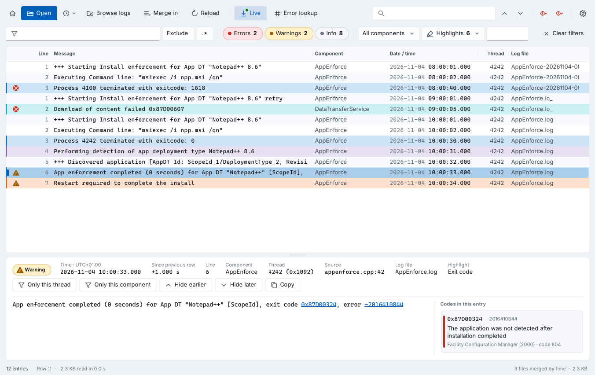
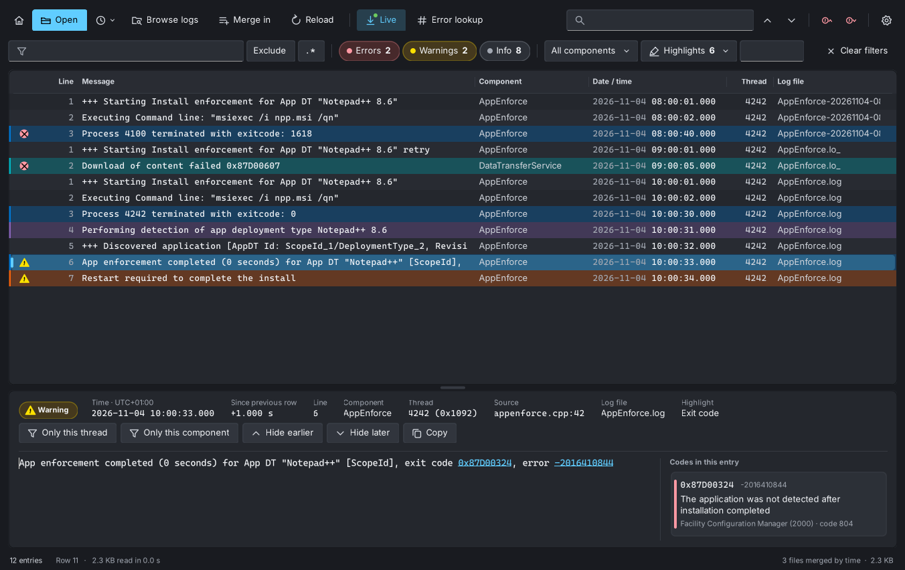
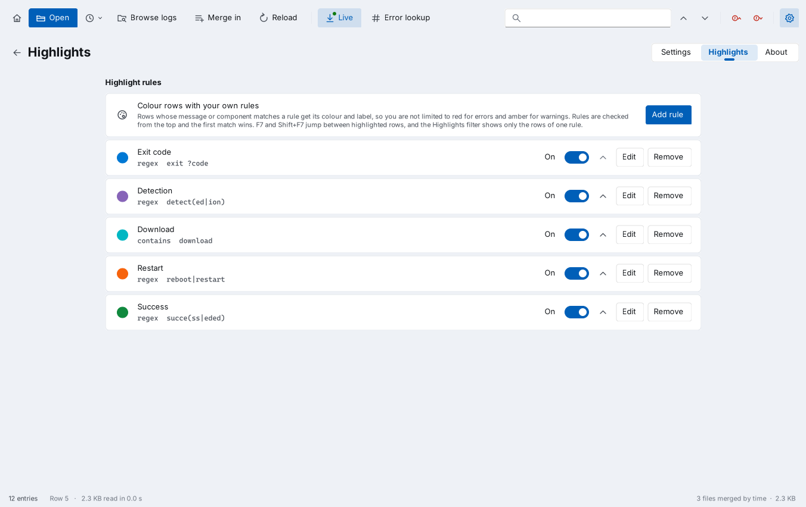

<p align="center">
  
</p>

<h1 align="center">Trace Lens</h1>

<p align="center">
  A fast, modern CMTrace-style log viewer for ConfigMgr, Intune and Windows logs.
</p>

<p align="center">
  
  
  
  
  <a href="LICENSE"></a>
</p>



Trace Lens opens the logs you read every day as an endpoint admin: ConfigMgr client and site server logs, Intune Management Extension logs, CBS, DISM and Panther logs, and Windows Update ETL traces. It reads large files in the background, merges several logs by time, follows them as they are written, and explains error codes, in a Windows 11 style window with light and dark themes.

It is one small exe with no installer requirement and nothing to configure. An MSI and a single PowerShell script are available too. Free and open source under the MIT license.

## Features

- **Large files, fast.** Logs are read in the background and only the visible rows are drawn, so a 500 MB log opens without freezing the window.
- **All the usual formats.** CMTrace (ConfigMgr and Intune IME), SMS trace, CBS, DISM and Panther, Windows Update ETL traces, and any plain text log with timestamps. UTF-8, UTF-16 and ANSI are detected.
- **Browse logs.** Finds ConfigMgr site server, management point, distribution point, console, client, client setup and task sequence logs, Intune Management Extension logs and Windows logs for you, on this computer or another one.
- **Connect as.** Read logs on a server with your admin account, without Run as or a second session.
- **Merge by time.** Open several logs and read them as one timeline. Auto-merge adds the rolled-over parts of a log (`.lo_`, dated copies, `CbsPersist_*`, `WindowsUpdate.*.etl`) by itself.
- **Live tail.** Follow logs while clients write them, including rollover.
- **Filters and find.** Filter by text or regex, severity, component, thread and time. Find with F3, jump between errors with F8.
- **Highlights.** Your own rules with a label, a match and a colour, for example *Detection*, *Download* or *Exit code*. Filter by rule and jump between them with F7.
- **Error lookup.** HRESULT, Win32, MSI, Windows Update and ConfigMgr codes are explained in the detail pane. Codes in a message are links.
- **Line numbers.** See where each entry is in the file, and press Ctrl+G to go to a line.
- **Administrator rights only when needed.** Trace Lens runs as a normal user and offers to restart as administrator when a log needs it.
- **Read-only and private.** Files are opened read-only with full sharing, so clients keep writing and rolling them. Nothing leaves the computer.

<table>
  <tr>
    <td></td>
    <td></td>
  </tr>
  <tr>
    <td align="center">Dark theme</td>
    <td align="center">Highlight rules</td>
  </tr>
</table>

## Download

Get the latest version from [Releases](../../releases). Pick the package that suits you:

| Package | Use it when |
|---|---|
| `TraceLens.msi` | You deploy to many devices with Intune or ConfigMgr. Installs per machine, adds a Start menu shortcut and *Open with* for `.log`, `.lo_` and `.etl` |
| `TraceLens.exe` | You want a portable tool on a USB stick, a share or a jump server. No install needed |

### Requirements

- Windows 10, Windows 11 or Windows Server 2016 or later
- .NET Framework 4.5 or later (included in all supported Windows versions)
- `TraceLens.ps1` needs Windows PowerShell 5.1 in Full Language mode

## Deploy with Intune or ConfigMgr

The MSI installs per machine, needs no restart and upgrades any earlier version in place.

| Setting | Value |
|---|---|
| Install command | `msiexec /i TraceLens.msi /qn` |
| Uninstall command | `msiexec /x {77F03080-EDFC-44B9-B5E7-BE515EA07AEE} /qn` |
| Detection | MSI product code `{77F03080-EDFC-44B9-B5E7-BE515EA07AEE}` (version 1.3.2) |
| Upgrade code | `{2A8DF866-E6D4-4A44-ABAC-C64CA0D367B3}` (the same for every version) |
| Install context | System |

Each new version has a new product code, listed in the [changelog](CHANGELOG.md). Add it as a new app that supersedes the earlier one.

## Usage

```powershell
# Open one log
TraceLens.exe C:\Windows\CCM\Logs\AppEnforce.log

# Open several logs merged by time
TraceLens.exe C:\Windows\CCM\Logs\AppDiscovery.log C:\Windows\CCM\Logs\AppEnforce.log

# Wildcards and remote computers work too
TraceLens.exe \\PC0123\C$\Windows\CCM\Logs\CcmExec*.lo*

# The script version takes the same arguments
.\TraceLens.ps1 C:\ProgramData\Microsoft\IntuneManagementExtension\Logs\IntuneManagementExtension.log
```

You can also drag files onto the window. Hold Ctrl while dropping to merge them into what is open.

### Keyboard shortcuts

| Keys | Action |
|---|---|
| Ctrl+O | Open logs |
| Ctrl+B | Browse logs |
| Ctrl+Shift+O | Merge in more logs |
| Alt+Home | Start page |
| Ctrl+F | Find |
| F3 / Shift+F3 | Next / previous match |
| F8 / Shift+F8 | Next / previous error |
| F7 / Shift+F7 | Next / previous highlighted row |
| Ctrl+G | Go to line |
| Ctrl+L | Error lookup |
| F5 | Reload |
| Ctrl+C | Copy selected rows |
| Ctrl+, | Settings, Highlights and About |

### Where logs are found

Browse logs looks in these places, on this computer and, through the admin shares, on other computers:

| Group | Folders |
|---|---|
| ConfigMgr | Site server and management point logs (from the registry or the default folder), `SMS_<site code>` shares, distribution point `SMS_DP$\sms\logs`, site setup, console `AdminUILog`, client `CCM\Logs`, `ccmsetup\Logs`, task sequence `SMSTSLog`, WSUS `LogFiles` |
| Intune | `C:\ProgramData\Microsoft\IntuneManagementExtension\Logs` |
| Windows | `C:\Windows\Logs\WindowsUpdate` (ETL), `SoftwareDistribution\ReportingEvents.log`, `C:\Windows\Logs` (CBS, DISM), Panther, `$WINDOWS.~BT`, `debug`, `Temp` |

Add your own folders, for example a share with collected logs, under Settings.

## Settings

Settings are stored per user in `HKEY_CURRENT_USER\Software\Trace Lens`. Delete that key to reset everything. Trace Lens writes nothing else, except a temporary copy of an ETL file while it is read.

## Build from source

Trace Lens is plain C# 5 and Windows Forms, with no NuGet packages.

**On Windows**, with the compiler that ships with .NET Framework:

```powershell
.\build.ps1          # TraceLens.exe and TraceLens.ps1
.\build.ps1 -Msi     # also TraceLens.msi, needs WiX Toolset 3
```

**On Linux or macOS**, with Mono and msitools:

```sh
./build.sh           # TraceLens.exe
./package.sh         # TraceLens.exe, TraceLens.ps1 and TraceLens.msi
```

| Path | Contents |
|---|---|
| `src/Core.cs` | Log store, parsers for each format, loader and error code tables |
| `src/Logs.Etl.cs` | ETW trace reader for ETL files |
| `src/Logs.Locations.cs` | Log discovery and auto-merge of spanned logs |
| `src/Net.Remote.cs` | Connect as: Windows sign-in dialog and SMB session |
| `src/Ui.*.cs` | The window, log grid, browser, settings and dialogs |
| `wrapper.ps1` | Template for `TraceLens.ps1`. The build places the C# source inside it |
| `TraceLens.wxs` | WiX source for the MSI |

## Known limitations

- The exe, MSI and script are unsigned. SmartScreen warns on downloaded copies, and AppLocker or WDAC need them signed with your own certificate.
- Windows Update traces from Windows Server 2016 and Windows 10 1607 and earlier need Microsoft symbol files. Run `Get-WindowsUpdateLog` for those.
- Browsing another computer needs an administrator account on it and SMB access. Local accounts other than the built-in Administrator are blocked over the network by Remote UAC.
- Merging sorts by the local time in each log, so logs from different time zones can interleave out of order.
- Logs are held in memory, about two to three times their size on disk.

## Changelog

See [CHANGELOG.md](CHANGELOG.md) for every version.

## Contributing

Bug reports, log samples that do not parse well, and ideas are welcome in [Issues](../../issues). Remove computer names, user names and other private data from logs before you attach them. Pull requests are welcome too. Please keep to C# 5 and .NET Framework 4.5 so Trace Lens keeps running on every supported Windows version without extra installs.

## License

Trace Lens is released under the [MIT license](LICENSE). You may use, change and share it freely, also at work and for customers.

## Author

Developed by **Daniel L. Baldissera**.
